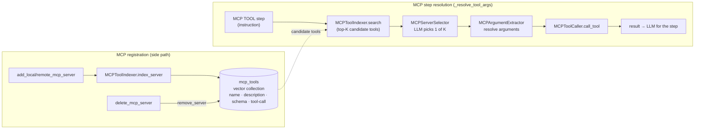

# Agent Flow (front-of-DAG agents)

How a user prompt is routed through the front-of-DAG agents
(SkillAgent, WebSearchAgent, MCPAgent, FetchAgent) and executed as DAG steps.

## High-level flow

## MCPAgent detail — "vector retrieves, LLM picks"

## Notes

- **The loop:** both `RouteNode` (from the prompt) and a matched skill in
  `SkillMatchNode` add agent step nodes via each node's `_extend_dag` result,
  so a skill invoking an MCP is the same code path as a direct trigger.
- **MCPAgent** only performs *selection*; the existing resolve→execute handlers
  call the tool and feed the result back (mirrors `FetchAgent`).
- **WebSearchAgent** is a stub — the search backend is still to be defined.
- `DAGExecutor` runs nodes with satisfied dependencies in parallel; the single
  local llama.cpp model instance serializes `LLMDecisionNode`s via a lock.
