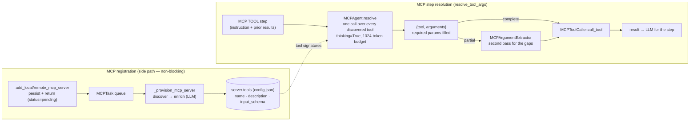

# Agent Flow (front-of-DAG agents)

How a user prompt is routed through the front-of-DAG agents
(SkillAgent, WebSearchAgent, MCPAgent, FetchAgent) and executed as DAG steps.

## High-level flow

## MCPAgent detail — "discovery is the catalog, the model resolves the call"

## Notes

- **The loop:** both `RouteNode` (from the prompt) and a matched skill in
  `SkillMatchNode` add agent step nodes via each node's `_extend_dag` result,
  so a skill invoking an MCP is the same code path as a direct trigger.
- **MCPAgent** performs *resolution*: one call over the tools discovery already
  recorded, answering with the tool and its required arguments. There is no
  vector index over tool descriptions — the discovered list is the catalog —
  and the call asks for reasoning (`thinking=True`) with an output budget big
  enough to hold the block, on a model declaring `ModelCapability.THINKING`
  when the workspace has one (see `ModelRouter.reasoning_llm` and
  `smartloop/agents/mcp/mcp_agent.py`). The resolve→execute handlers still call
  the tool and feed the result back (mirrors `FetchAgent`), and both emit the
  call — `Resolved notion.notion-search(query='…')` — on the progress stream.
- **Registration never blocks**: `add_*_mcp_server` persists the connection and
  returns `status="pending"`. Tool discovery (a process launch or a remote
  handshake) and LLM enrichment run on `MCPTask`, which records
  `ready`/`failed` + `last_error` for clients to poll. Nothing is indexed:
  discovery's tool list is the catalog, so a connection is usable the moment it
  is discovered.
- **A connected server is a source, asked live**: `Explorer.collect_parallel`
  resolves and runs a read-only tool for the question alongside documents,
  workspace files, feedback and the web. Content used to be crawled and
  vectorized into `mcp_documents` ahead of time, and the live call was skipped
  whenever that index matched; that is gone, so an answer about a Notion page
  comes from Notion rather than from a snapshot.
- **WebSearchAgent** is a stub — the search backend is still to be defined.
- `DAGExecutor` runs nodes with satisfied dependencies in parallel; the single
  local llama.cpp model instance serializes `LLMDecisionNode`s via a lock.
