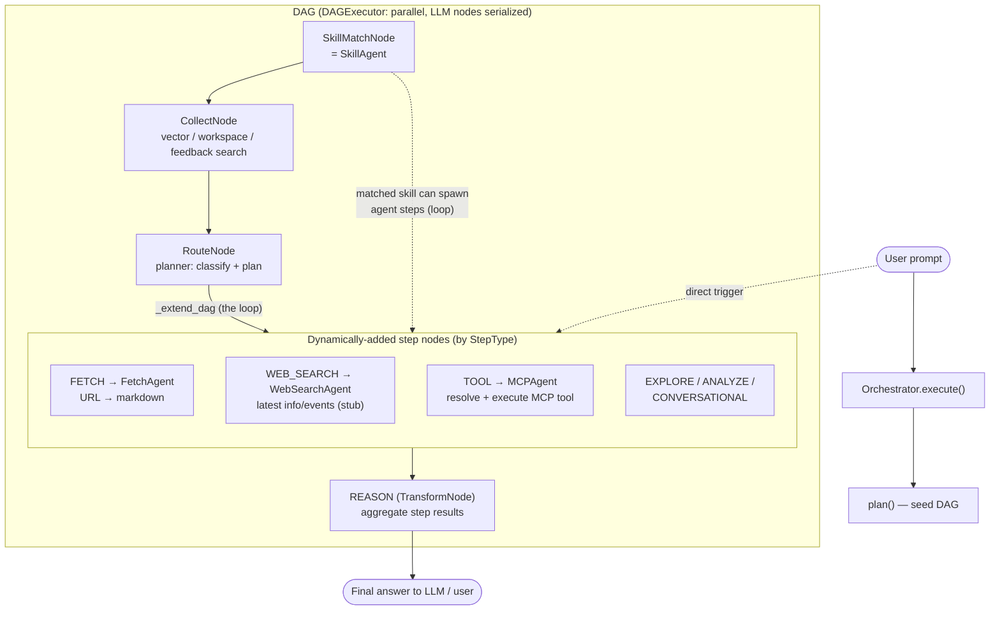
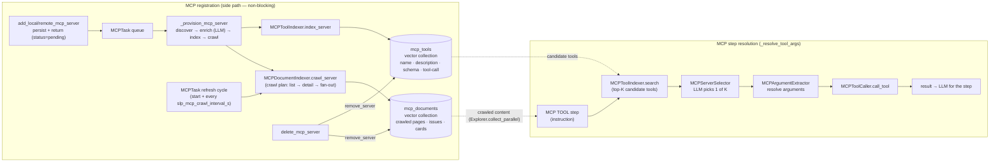

# Agent Flow (front-of-DAG agents)

How a user prompt is routed through the front-of-DAG agents
(SkillAgent, WebSearchAgent, MCPAgent, FetchAgent) and executed as DAG steps.

## High-level flow

## MCPAgent detail — "vector retrieves, LLM picks"

## Notes

- **The loop:** both `RouteNode` (from the prompt) and a matched skill in
  `SkillMatchNode` add agent step nodes via each node's `_extend_dag` result,
  so a skill invoking an MCP is the same code path as a direct trigger.
- **MCPAgent** only performs *selection*; the existing resolve→execute handlers
  call the tool and feed the result back (mirrors `FetchAgent`).
- **Registration never blocks**: `add_*_mcp_server` persists the connection and
  returns `status="pending"`. Tool discovery (a process launch or a remote
  handshake), LLM enrichment, tool indexing and the first content crawl all run
  on `MCPTask`, which records `ready`/`failed` + `last_error` for clients to poll.
- **Document-type servers are crawled, not just called**: a crawl plan
  (`smartloop/mcp/crawl_plans.py`) walks a Notion/Linear/Trello connection's
  listing tools — with per-record detail calls and parent→child fan-out — and
  vectorizes the results into `mcp_documents`. `Explorer.collect_parallel`
  searches that collection alongside documents/workspace/feedback, so the
  content is in context without depending on the router picking the right live
  call. The cycle re-crawls at startup and on an interval; hashes in
  `.mcp_documents_manifest.json` keep a refresh to what actually changed.
- **WebSearchAgent** is a stub — the search backend is still to be defined.
- `DAGExecutor` runs nodes with satisfied dependencies in parallel; the single
  local llama.cpp model instance serializes `LLMDecisionNode`s via a lock.
