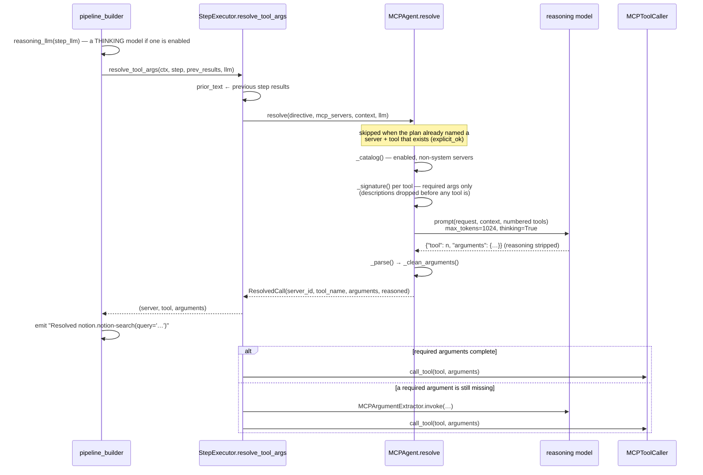
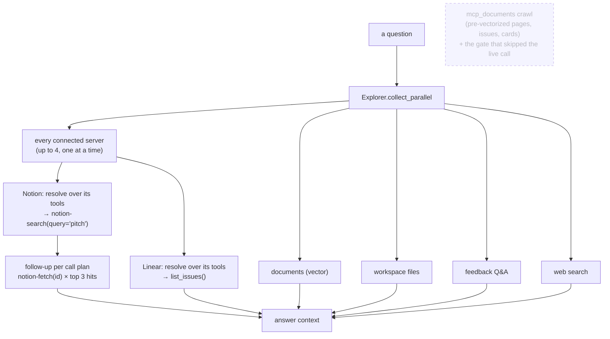
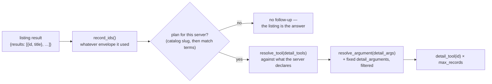
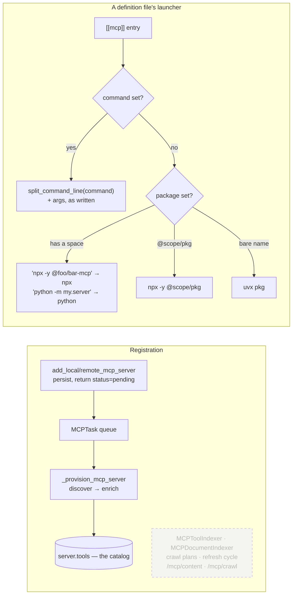

# MCP tool resolution — what changed, and where to check it

Four changes, drawn against the code that implements them:

1. **No indexing.** The `mcp_tools` vector index and the content crawl
   (`mcp_documents`) are both gone. Discovery's tool list **is** the catalog,
   and a server's content is read by calling its tools when a question needs
   them — so nothing indexes at startup. The crawl plans' per-server knowledge
   survives as `call_plans.toml`, driving a live follow-up call instead of a
   background walk.
2. **One reasoned call.** Resolution picks the tool *and* fills its required
   arguments in a single pass, with `thinking=True` and an output budget big
   enough for the reasoning block — and the answer runs with `thinking=False`,
   so the reasoning budget is spent on the decision rather than on the stream
   the user is waiting for.
3. **The call is shown.** The client sees which call was resolved and which
   went out, not just which model was selected.
4. **Launchers belong to the server.** A definition file names `npx`, `python`
   or a path; `uvx` is only the default for a bare package name.

## 1. Resolution: before → after

```mermaid
flowchart LR
    subgraph BEFORE["Before — two calls, neither saw the other"]
        direction TB
        B1["MCP TOOL step"] -->|"embed the instruction"| B2[["MCPToolIndexer.search<br/>top-K by cosine distance"]]
        B2 --> B3{{"LLM picks 1 of K<br/>names + descriptions only"}}
        B3 -->|"tool, no arguments"| B4{{"MCPArgumentExtractor<br/>second prompt, no tool list"}}
        B4 --> B5["call_tool"]
        B6[("mcp_tools<br/>vector collection<br/>re-embedded per server")] -.->|candidates| B2
    end

    subgraph AFTER["After — one call over the whole catalog"]
        direction TB
        A1["MCP TOOL step<br/>+ prior step results"] --> A2{{"MCPAgent.resolve<br/>every discovered tool as a signature<br/>thinking=True, 1024-token budget"}}
        A2 -->|'{tool, arguments}'| A3["clean: drop undeclared,<br/>echoed, fabricated values"]
        A3 -->|"required args complete"| A5["call_tool"]
        A3 -->|"required args missing"| A4{{"MCPArgumentExtractor<br/>fallback for the gaps only"}}
        A4 --> A5
        A6[("server.tools in config.json<br/>written once by discovery")] -.->|signatures| A2
    end
```

`{{ }}` is an LLM call. The `after` path makes one where the `before` path made
two, and the second one is reached only when the first left a required argument
unfilled.

## 2. The resolve call itself



**Why it always reasons — and why the answer never does.** Reasoning is how a
tool call is course-corrected into the right tool with the right arguments, so
it is spent here and nowhere else. `thinking` is a per-call argument: the
resolve call passes `True`, the answer passes `False`, and both travel with the
request — through `LlamaCpp.invoke`/`_stream`, which flip `_slp_thinking` for
the duration of one call and restore it, or over the wire to the model host
when the weights live there. A `<think>` block on the answer would buy nothing
(the decision is already made and its results are in the context) and cost the
whole stream, because the filter withholds every token of a thought the reader
never sees. The budget matters too: `_thinking_for_budget` suppresses the block
under `THINKING_MIN_BUDGET` (512), so resolution asks for 1024, clamped to
whatever context is left.

**Which model.** `ModelRouter.reasoning_llm` routes the resolve node to a model
declaring `ModelCapability.THINKING` when the workspace has one enabled — best
effort, so it never forces a load. A model the registry does not describe (a
user build, a merge) still counts: `LlmFactory` binds the flag whenever the
GGUF's own chat template reads `enable_thinking`.

## 3. What a question now searches



Three things changed here. The live call used to be skipped whenever the
crawled copy matched, so a question about Notion was answered from a snapshot —
the snapshot is gone. Resolution used to run once across the whole workspace,
picking one tool for every server — now each server is asked separately, over
its own (smaller, better described) tool list, so a question spanning two
servers gets both. And a listing is followed to its bodies: `notion-search`
returns hits, the plan says `notion-fetch` reads a page, so the answer is
written from the page.

A tool is auto-run here only when its name reads as read-only — every word is
checked, so `notion-search` and `trelloReadCard` run while `notion-create-pages`
stays a planned step.

### The follow-up plan



`call_plans.toml` carries this per server (Notion, Linear, Trello, Canva,
monday ship bundled; a `[[plan]]` entry in any user file adds or replaces one).
It is what survived the crawl plans: the walk is gone, the knowledge of *which
tool fetches a record and under which argument* is not.

## 4. Registration and launchers



`args` also accepts one string (`args = "-y some-mcp"`), split the way a shell
would; `args` with no command is a load-time error naming the field; and a
command that is a path to a program no longer has to invent an argument to pass
registration.

## Where to check each claim

| Claim | Code | Test |
| --- | --- | --- |
| Catalog comes from discovery, not an index | `mcp_agent.py` `_catalog` | `test_mcp_tool_resolution.py::TestTheCatalogIsDiscovery` |
| Only required arguments are shown | `mcp_agent.py` `_signature` | `…::test_the_prompt_lists_every_discovered_tool_with_its_required_args` |
| Descriptions are dropped before tools are | `mcp_agent.py` `_prompt` | `…::TestTheCatalogIsDiscovery` |
| Reply parsed as number / name / bare digit | `mcp_agent.py` `_parse` | `…::TestParsingWhatModelsActuallyEmit` |
| Fabricated + echoed values dropped | `mcp_agent.py` `_clean_arguments` | `…::TestArgumentsAreCleaned` |
| The call asks for thinking + room to think | `mcp_agent.py` `resolve` | `…::TestReasoningGetsRoomToThink` |
| Only the tool call reasons; the answer does not | `chat.py`, `llama_cpp.py` `_thinking_override` | `test_thinking_is_for_the_tool_call.py` |
| Thinking travels to the model host | `remote_llm.py`, `model_host/client.py` | `test_remote_llm.py` |
| A thinking-capable model runs resolution | `model_router.py` `reasoning_llm` | — (routing, exercised in `pipeline_builder`) |
| Resolution's arguments are used as returned | `step_executor.py` | `test_mcp_resolution_fills_arguments.py` |
| The resolved call is shown to the user | `pipeline_builder.py`, `mcp_agent.format_call` | `test_tool_call_progress.py` |
| Every source is searched, servers included | `explorer.py` `collect_parallel` | `test_context_precedence.py` |
| Every server is asked, not just the best match | `explorer.py` `_run_mcp` | `test_mcp_collect_gather.py` |
| A listing is followed to the record bodies | `call_plans.py` `follow_up_calls` | `test_mcp_call_plans.py` |
| `notion-search` counts as read-only | `explorer.py` `_is_read_only_tool` | `test_context_precedence.py` |
| Provisioning neither indexes nor crawls | `model_service.py` `_provision_mcp_server` | `test_mcp_background_provisioning.py` |
| A file names its own launcher | `definitions.py` `launch` | `test_mcp_definitions.py::TestLaunchers` |
